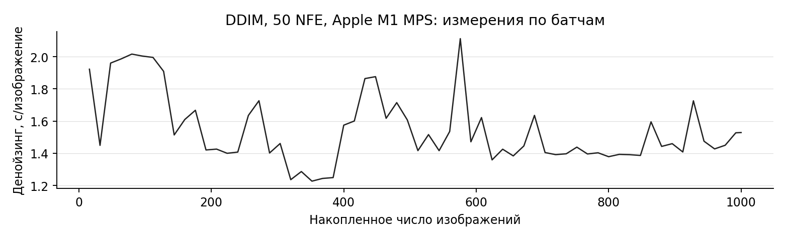
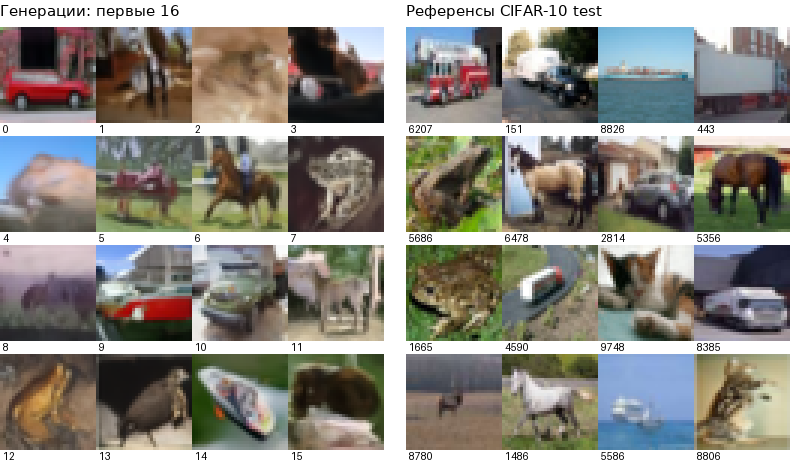

# Методы генерации из диффузионных моделей

1. Постановка задачи

Цель проекта - сравнить методы генерации из диффузионных моделей по качеству изображений и вычислительным затратам, а также исследовать влияние расписания шума. На первом этапе воспроизведён baseline, проверен интерфейс модели и составлен план экспериментов. Во всех конфигурациях предполагается использовать одни и те же предобученные веса без дообучения.

В качестве baseline выбран готовый DDIM из Diffusers: 50 шагов, η = 0, стандартное расписание leading. Дальше планируется реализовать DDIM, DPM-Solver++ второго порядка и Heun в нотации EDM, проверить их по библиотечным аналогам и исследовать подбор расписания. В отчёте представлены измерения библиотечного DDIM.

Данные и модель

Используется CIFAR-10: 60 000 цветных изображений 32×32, десять классов. Исходное разбиение содержит 50 000 train и 10 000 test. Предобученная google/ddpm-cifar10-32 содержит 35 746 307 параметров и генерирует изображения без текстового или классового условия.

Для FID из test-части выбраны 1000 изображений: по 100 каждого класса, с фиксированным seed. Индексы сохранены отдельно. Train-часть в этом эксперименте не используется. Данные скачаны из зеркала uoft-cs/cifar10 в формате Parquet. Test-часть загружена отдельно, поскольку скачивание полного архива с исходного сервера занимало значительно больше времени.

Ресурсы

Все измерения выполнены локально на MacBook Air M1 и 16 ГБ общей памяти. Использован backend MPS, float32 и батч 16, Python 3.12.10, PyTorch 2.8.0, Diffusers 0.35.2. Фактическая скорость измерена, а размер выборки ограничен 1000 изображениями.

---

## 2. Модель и три метода сэмплирования

Что получает и предсказывает сеть

В обозначениях VP-диффузии aₜ = √ᾱₜ, bₜ = √(1 − ᾱₜ), где ᾱₜ - накопленное произведение коэффициентов. Прямой процесс записывается как xₜ = aₜx₀ + bₜε. U-Net получает тензор B×3×32×32 и номер шага t, возвращает тензор той же формы. В выбранном checkpoint выход интерпретируется как предсказание шума ε. В конфигурации scheduler задано prediction_type='epsilon', соответствующее параметризации модели.

ε-предсказание: x̂₀ = (xₜ − bₜε̂)/aₜ.
Предсказание данных: x̂₀ = выход сети.
v-предсказание: v = aₜε − bₜx₀, поэтому x̂₀ = aₜxₜ − bₜv̂.

Функция prediction_to_x0 переводит выход сети в оценку x₀ с учётом параметризации. Формулы проверены на синтетических данных и сравнением с DDIMScheduler на выходе модели. Клиппинг x̂₀ в [−1, 1] применяется там же, где его применяет выбранный scheduler.

DDIM

При η = 0 переход детерминирован: из текущего xₜ получается оценка x̂₀, после чего строится состояние на меньшем уровне шума. Для перехода t → s используется xₛ = aₛx̂₀ + bₛε̂. Нужен один вызов сети на шаг. В baseline используется библиотечный шаг со стандартными настройками клиппинга. Начальный шум создаётся на CPU и сохраняется для повторных запусков.

DPM-Solver++ второго порядка, многошаговый вариант

Метод интегрирует диффузионное ODE через предсказание данных x̂₀ и использует историю предыдущего шага. Для λ = log(a/b), h = λᵢ₊₁ − λᵢ и r = hпред/h экстраполяция имеет вид D̃ᵢ = (1 + 1/(2r))Dᵢ − Dᵢ₋₁/(2r), где Dᵢ - оценка x₀. Обновление: xᵢ₊₁ = (bᵢ₊₁/bᵢ)xᵢ + aᵢ₊₁(1 − exp(−h))D̃ᵢ. Первый шаг выполняется без истории первым порядком. После старта нужен один новый вызов сети на шаг. Правило последнего шага также должно совпасть с выбранным библиотечным аналогом.

Heun и связь с EDM

Для DDPM ввожу y = xₜ/aₜ и σ = bₜ/aₜ. Тогда денойзер D(y, σ) = y − σε̂(aₜy, t), а производная F(y, σ) = (y − D)/σ. Heun сначала делает Euler-прогноз, затем усредняет производные в начале и конце перехода. Такая замена переменных позволяет применить схему второго порядка из EDM к выбранной DDPM-модели.

При конечном σ = 0 последний переход выполняется Euler-шагом. Для K переходов получается 2K − 1 вызовов сети. Поэтому равные K у DDIM и Heun не означают одинаковый бюджет. При реализации Heun необходимо проверить соответствие σ обучающим шагам t и масштабирование входа сети.

---

## 3. Воспроизведение baseline

Перед длинным запуском проверены размерности, конечность выходов, преобразование ε → x₀ и повторная генерация. Для проверки скорости выполнены короткие прогоны на 10 шагах с батчами 1, 4, 8 и 16. Проверочный запуск с батчем 16 на 50 шагах занял 22,65 с. Эта конфигурация использована в основном эксперименте.

Максимальная абсолютная ошибка между собственным восстановлением x₀ с клиппингом и pred_original_sample scheduler составила 0.0e+00. Два прогона с одинаковыми входами и одинаковым размером батча дали побитово одинаковые uint8-изображения. Пройдены семь автоматических тестов обвязки и сохранения измерений. Генерация выполнялась с замороженными параметрами сети.

| Показатель | Получено |
| --- | --- |
| FID, 1000 генераций против 1000 test-изображений | 57.440 |
| Метод и шаги | DDIM, 50 шагов, η = 0 |
| NFE на траекторию одного изображения | 50 |
| Фактические батчевые вызовы U-Net | 3150 |
| Вызовы, взвешенные по числу изображений | 50000 |
| Суммарное время денойзинга | 1545.82 с |
| Среднее время на изображение | 1.546 с |
| Повторы одного батча, среднее ± стандартное отклонение | 23.43 ± 1.19 с, n = 3 |

Число вызовов сети измерено с помощью forward-hook. Последний батч содержит восемь изображений. Для сравнения вычислительного бюджета используется NFE на одну траекторию. Сумма батчевых вызовов зависит также от батча и размера выборки. Замер времени синхронизирован с MPS до и после цикла. Загрузка, прогрев, сохранение файлов и вычисление FID в время денойзинга не включены.

Рисунок 1. Время денойзинга на изображение по батчам. Источник: batch_metrics.csv, основной эксперимент.

---

## 4. Примеры и протокол оценки

Рисунок 2. Слева первые 16 сгенерированных изображений. Справа первые 16 изображений фиксированной реальной выборки. Исходное разрешение 32×32, увеличение nearest-neighbour.

В генерациях читаются характерные сюжеты CIFAR-10: у №0 виден красный автомобиль, №6 напоминает лошадь, у №9 различим силуэт судна. У №2 и №13 объект определяется хуже: силуэт расплывчатый, отдельные части сливаются с фоном. Качественная оценка относится к этим примерам. Модель генерирует изображения без меток классов.

По сравнению с реальными примерами у части генераций менее чёткие границы и менее убедительные локальные детали. При этом реальные изображения тоже имеют низкое разрешение. Сравнение с реальными примерами помогает учесть ограничения разрешения 32×32. Для оценки разнообразия и частоты повторов потребуется анализ всей выборки.

Как посчитан FID

Использован стандартный Inception-v3-compat из torch-fidelity 0.3.0 с 2048 признаками и фиксированными весами. На вход подаются RGB uint8-изображения 32×32. Приведение к размеру 299×299 выполняет сам экстрактор с совместимой интерполяцией. Признаки вычислены на MPS, средние и ковариации для FID - в float64 на CPU.

FID = ||μreal − μgen||² + Tr(Σreal + Σgen − 2√(ΣrealΣgen)). Меньше означает более близкие распределения признаков, но не гарантирует корректность каждого изображения.

FID рассчитан один раз на общей выборке. Его доверительный интервал не оценивался. Три повтора времени не являются тремя независимыми измерениями FID. При 1000 изображений оценка имеет заметное смещение и нестабильность, а ковариация в пространстве 2048 признаков вырождена. Численный результат является предварительным baseline. Его нельзя напрямую сопоставлять с опубликованным FID 3,17: отличаются число сэмплов, разбиение и способ генерации.

---

## 5. План экспериментов

Ось 1 - метод: DDIM, DPM-Solver++ 2M и Heun. Ось 2 - бюджет: 19, 39 и 79 NFE. Нечётные бюджеты выбраны, чтобы Heun мог использовать ровно 10, 20 и 40 переходов с последним Euler-шагом. Ось 3 - стандартное расписание: равномерные обучающие t и равномерные log σ. Получается 18 конфигураций. Уровни лежат в диапазоне, поддерживаемом выбранной DDPM. Правила конечного шага фиксируются явно.

Сначала сравню конфигурации на 256 одинаковых начальных шумах. По результатам этой проверки отберу варианты для основного эксперимента. Четыре выбранные конфигурации затем проверю на 1000 изображений с тремя независимыми seed. Для каждого запуска сохраняются FID, NFE, время и изображения. Реальная выборка и экстрактор остаются прежними. Время сравнивается после прогрева при одинаковом батче и точности. Настройка расписания учитывается отдельно.

До сравнения собственный шаг каждого метода должен совпасть с библиотечным аналогом при одинаковых входах, параметризации, расписании и граничных правилах. На CPU проверяется ошибка float32 с ориентиром 10⁻⁵, на MPS - 10⁻⁴. При большем расхождении анализируются промежуточные состояния. Для Heun отдельно проверю порядок вызовов, а для DPM-Solver++ - старт без истории и последний шаг.

Подбор уровней шума

Для 32 отдельных настроечных шумов построю детерминированный ориентир DDIM на 200 шагах. Оптимизируемая величина - MSE конечного непрерывного изображения относительно этого ориентира при том же шуме, до округления в uint8. Длинный прогон служит целевым изображением для каждого начального шума. Подбор расписания проводится по MSE. FID используется при итоговой оценке.

В log σ задам три внутренних опорных уровня. Концы траектории фиксированы. Буду поочерёдно сдвигать одну опору, проверяя пять соседних допустимых положений и оставляя вариант с меньшей средней MSE. После двух проходов выбранные опоры интерполируются в полное расписание. Число уровней и NFE сохраняются. Неупорядоченные уровни, совпавшие после привязки к обучающей сетке, отвергаются.

Рабочая гипотеза: уплотнение средней и поздней части траектории лучше сохраняет границы и мелкие детали, чем равномерное размещение t. Для проверки гипотезы сравню уплотнение начала, середины и конца траектории. Для новых уровней нужно согласовать t с σ и не выходить за обучающий диапазон. Собственный DDIM будет получать текущий и следующий уровни явно: библиотечный шаг с фиксированным интервалом нельзя без проверки использовать для произвольной сетки.

Переносимость и критерий успеха

Выбранное расписание проверю на 128 новых шумах, затем по FID на отложенных 1000, а также на другом сэмплере при том же бюджете. Снижение MSE само по себе не доказывает улучшение FID. Успехом считаю снижение FID при одинаковом NFE либо сокращение NFE минимум на 20% при росте среднего FID не более чем на два пункта на общем протоколе. Эти пороги будут использованы при оценке результатов второго этапа.

---

## 6. Воспроизводимость и следующие шаги

В репозитории сохранены config.json, точные версии зависимостей, ревизия и SHA256 весов, исходные шумы, индексы реальных изображений, полученные сэмплы, признаки Inception, таблицы и журнал выполнения. README описывает запуск на macOS. Скрипт загрузки использует зафиксированные источники и проверяет контрольные суммы. Прогресс прерванной генерации сохраняется в progress.json вместе с параметрами запуска.

Порядок запуска: установить зависимости в отдельное окружение, выполнить download_assets.py, затем run.py sanity, run.py baseline и run.py evaluate. Устройство задаётся --device mps или --device cpu. Рисунки по сохранённым результатам строятся скриптом make_figures.py. Проверки находятся в test_contract.py.

На этапе 2 сначала реализую и проверю три сэмплера, затем сравню стандартные расписания, после этого запущу подбор опорных уровней. Основные риски: ошибка масштабирования DDPM/EDM, различия граничных шагов, переобучение расписания на 32 шумах и расхождение между MSE и FID. Их контролируют тесты промежуточных состояний, раздельные настроечные шумы и финальная проверка на новых входах. Из-за ограничений времени на M1 увеличение выборки для FID запланировано после отбора конфигураций.

Выводы

Первый этап дал воспроизводимую точку отсчёта: DDIM на 50 шагах, FID 57.440 на выборках 1000/1000 и 1.546 с денойзинга на изображение при батче 16. Проверена связь ε-предсказания U-Net с шагом scheduler, зафиксированы входы и условия измерения. Качество отдельных изображений неоднородно, а размер выборки ограничивает точность оценки FID. На следующем этапе предстоит сравнить собственные реализации и проверить, даёт ли подбор расписания улучшение при том же вычислительном бюджете.
